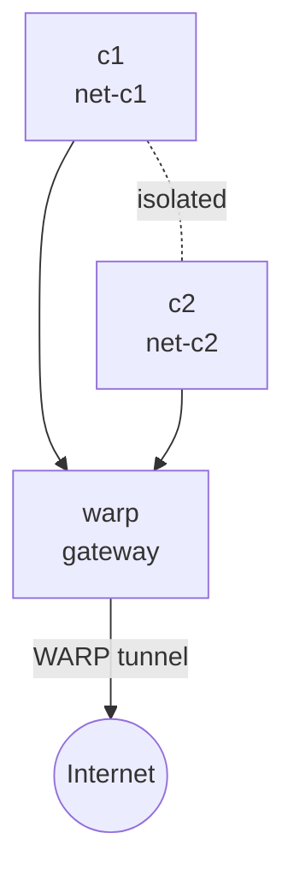
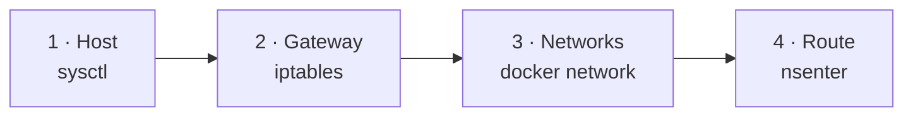
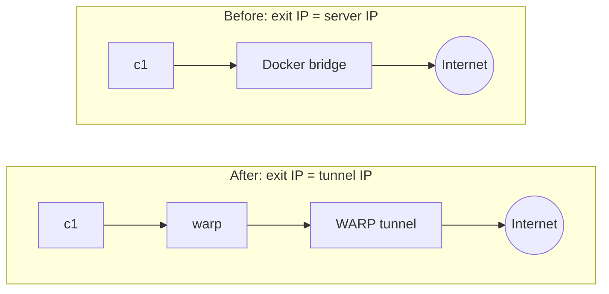

# docker-container-networking

**English** · [Türkçe](README.tr.md)

Give Docker containers their **own networks** and send all of them out to the internet through **one shared gateway container**. Containers stay isolated from each other, and the exit IP is not the server's IP.



## How it works

1. Each container lives in its own bridge network (`net-c1`, `net-c2`).
2. The gateway container (`warp`) is attached to every network, with a separate IP on each.
3. The container's default route is switched to the gateway IP on its own network.
4. The gateway forwards traffic into the tunnel (`CloudflareWARP`).
5. Traffic between networks is blocked on the gateway.

## Setup



**1. Host settings**
```bash
sysctl -w net.ipv4.ip_forward=1
sysctl -w net.ipv4.conf.all.rp_filter=0
sysctl -w net.ipv4.conf.default.rp_filter=0
sysctl -w net.bridge.bridge-nf-call-iptables=1
```

**2. Gateway rules** (`warp` must be running and have `iptables` installed)
```bash
docker exec -u root warp iptables -t nat -A POSTROUTING -o CloudflareWARP -j MASQUERADE
docker exec -u root warp iptables -A FORWARD -i 'eth+' -o CloudflareWARP -j ACCEPT
docker exec -u root warp iptables -A FORWARD -i CloudflareWARP -o 'eth+' -m state --state RELATED,ESTABLISHED -j ACCEPT
docker exec -u root warp iptables -A FORWARD -i 'eth+' -o 'eth+' -j DROP
```

**3. Networks and containers**
```bash
docker network create --driver bridge --subnet 172.31.1.0/24 --opt com.docker.network.driver.mtu=1340 net-c1
docker network create --driver bridge --subnet 172.31.2.0/24 --opt com.docker.network.driver.mtu=1340 net-c2

docker network connect net-c1 warp
docker network connect net-c2 warp

docker run -dit --network net-c1 --dns 1.1.1.1 --name c1 <image>
docker run -dit --network net-c2 --dns 1.1.1.1 --name c2 <image>
```

**4. Point the default route at the gateway**
```bash
warp_ip=$(docker inspect -f '{{index .NetworkSettings.Networks "net-c1" "IPAddress"}}' warp)
pid=$(docker inspect -f '{{.State.Pid}}' c1)
nsenter -t $pid -n ip route replace default via $warp_ip
```
Repeat for `c2` with `net-c2`.



## What the rules do

| Rule | Purpose |
|---|---|
| `POSTROUTING ... MASQUERADE` | Rewrites the source IP of outgoing packets to the tunnel IP |
| `FORWARD -i eth+ -o CloudflareWARP ACCEPT` | Allows container → internet traffic |
| `FORWARD ... RELATED,ESTABLISHED` | Lets back only replies to connections opened from the inside |
| `FORWARD -i eth+ -o eth+ DROP` | Cuts traffic between `net-c1` and `net-c2` |

## Test

```bash
docker exec c1 wget -qO- https://1.1.1.1/cdn-cgi/trace | grep warp   # warp=on
docker exec c1 ping -c1 -W1 172.31.2.2                                # should fail
```

## Watch out

- **Use `eth+`, not `eth0`.** The gateway gets a separate `ethN` for each network.
- **The DROP rule must come after the ACCEPT rules**, otherwise containers can reach each other.
- **Use `replace`, not `route del` + `add`.** In the gap between them, traffic can leave through the server's own IP.
- **MTU 1340.** The tunnel MTU is below 1500; without this, large packets stall.
- **Change the route with `nsenter`, not `docker exec`.** Running commands inside a container is not safe.
- **Restarts wipe everything.** Re-apply the route when a container restarts and the rules when the gateway restarts (a cron job can do it). Sysctl settings are lost on reboot; put them under `/etc/sysctl.d/`.

## License

[MIT](LICENSE)
