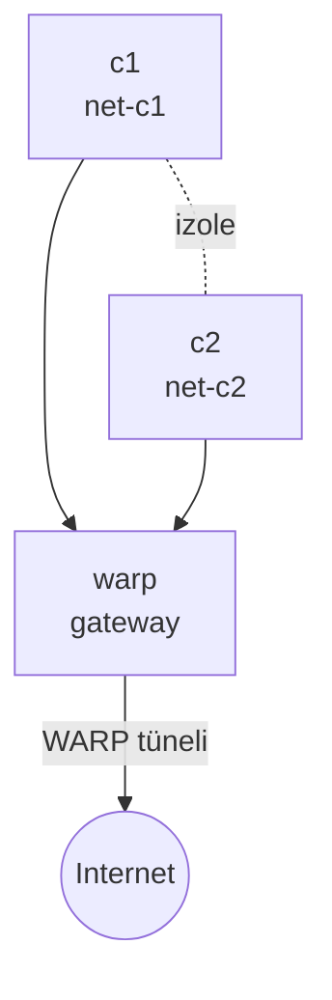
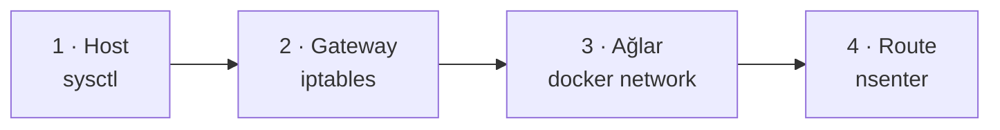
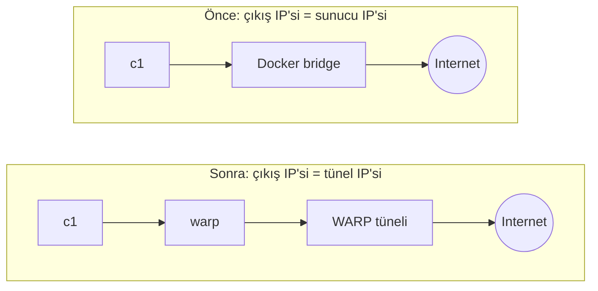

# docker-container-networking

[English](README.md) · **Türkçe**

Docker container'larına **ayrı ağ** verip, hepsini **tek bir gateway container'ı** üzerinden internete çıkarma örneği. Container'lar birbirinden izole kalır, çıkış IP'si sunucunun IP'si olmaz.



## Nasıl çalışır

1. Her container kendi bridge ağında (`net-c1`, `net-c2`).
2. Gateway container'ı (`warp`) her ağa bağlı, her ağda ayrı IP'si var.
3. Container'ın default route'u, kendi ağındaki gateway IP'sine çevrilir.
4. Gateway trafiği tünele (`CloudflareWARP`) yollar.
5. Ağlar arası geçiş gateway'de engellenir.

## Kurulum



**1. Host ayarları**
```bash
sysctl -w net.ipv4.ip_forward=1
sysctl -w net.ipv4.conf.all.rp_filter=0
sysctl -w net.ipv4.conf.default.rp_filter=0
sysctl -w net.bridge.bridge-nf-call-iptables=1
```

**2. Gateway kuralları** (`warp` çalışıyor ve içinde `iptables` kurulu olmalı)
```bash
docker exec -u root warp iptables -t nat -A POSTROUTING -o CloudflareWARP -j MASQUERADE
docker exec -u root warp iptables -A FORWARD -i 'eth+' -o CloudflareWARP -j ACCEPT
docker exec -u root warp iptables -A FORWARD -i CloudflareWARP -o 'eth+' -m state --state RELATED,ESTABLISHED -j ACCEPT
docker exec -u root warp iptables -A FORWARD -i 'eth+' -o 'eth+' -j DROP
```

**3. Ağlar ve container'lar**
```bash
docker network create --driver bridge --subnet 172.31.1.0/24 --opt com.docker.network.driver.mtu=1340 net-c1
docker network create --driver bridge --subnet 172.31.2.0/24 --opt com.docker.network.driver.mtu=1340 net-c2

docker network connect net-c1 warp
docker network connect net-c2 warp

docker run -dit --network net-c1 --dns 1.1.1.1 --name c1 <imaj>
docker run -dit --network net-c2 --dns 1.1.1.1 --name c2 <imaj>
```

**4. Default route'u gateway'e çevir**
```bash
warp_ip=$(docker inspect -f '{{index .NetworkSettings.Networks "net-c1" "IPAddress"}}' warp)
pid=$(docker inspect -f '{{.State.Pid}}' c1)
nsenter -t $pid -n ip route replace default via $warp_ip
```
`c2` için aynısını `net-c2` ile tekrarlayın.



## Kurallar ne yapar

| Kural | Görevi |
|---|---|
| `POSTROUTING ... MASQUERADE` | Çıkan paketlerin kaynak IP'sini tünel IP'si yapar |
| `FORWARD -i eth+ -o CloudflareWARP ACCEPT` | Container → internet geçişine izin verir |
| `FORWARD ... RELATED,ESTABLISHED` | Sadece içeriden açılmış bağlantıların cevabını geri alır |
| `FORWARD -i eth+ -o eth+ DROP` | `net-c1` ile `net-c2` arasındaki geçişi keser |

## Test

```bash
docker exec c1 wget -qO- https://1.1.1.1/cdn-cgi/trace | grep warp   # warp=on
docker exec c1 ping -c1 -W1 172.31.2.2                                # başarısız olmalı
```

## Dikkat

- **`eth0` değil `eth+` yazın.** Gateway her ağ için ayrı `ethN` alır.
- **DROP kuralı ACCEPT'lerden sonra gelmeli**, yoksa container'lar birbirine ulaşır.
- **`route del` + `add` değil `replace` kullanın.** Aradaki boşlukta trafik sunucunun IP'sinden çıkabilir.
- **MTU 1340.** Tünel MTU'su 1500'den küçük, yoksa büyük paketler takılır.
- **Route'u `docker exec` ile değil `nsenter` ile değiştirin.** Container içinde komut çalıştırmak güvenli değil.
- **Restart her şeyi siler.** Container yeniden başlarsa route'u, gateway yeniden başlarsa kuralları tekrar uygulayın (cron ile yapılabilir). Sysctl ayarları reboot'ta gider, `/etc/sysctl.d/` altına yazın.

## Lisans

[MIT](LICENSE)
